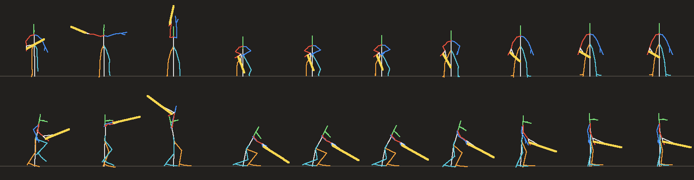
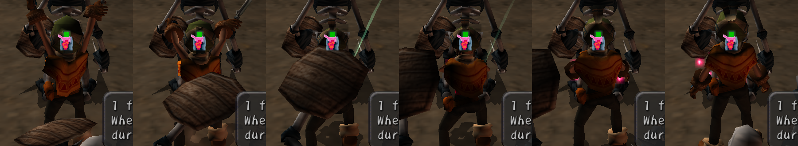
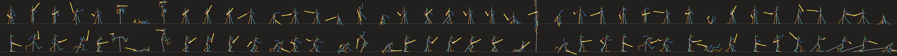

# Making new character animations

This guide is for modders who want a Dark Cloud character to do something the game never animated: a new attack, a
dodge, a taunt. You write the motion as a short Python script against the character's real skeleton. The tools turn
it into a motion file your mod ships. A few lines of Lua then hand it to the game and bind it to a button.

You'll build one motion end to end, Toan's **Overhead Chop** (run, then attack). It's in
[`examples/new-move`](../examples/new-move), so you can run it first and then change it.

| The Overhead Chop's poses (stick figures, front and side) | In game |
|---|---|
|  |  |

Contents: [What you need](#what-you-need) · [How it works](#how-it-works-in-two-minutes) ·
[Walkthrough](#walkthrough-the-overhead-chop) · [Making it look natural](#making-it-look-natural) ·
[Troubleshooting](#troubleshooting) · [Other characters](#other-characters) · [Reference](#reference)

## What you need

- **The Chronicle port with the MoonFactory engine**, set up with your game data. The tools read the character files
  in your data folder's `dun/mainchara/`: for each character a `.chr` pack, a `.gltf` and a `.game.json`. Setting up
  the data creates them. Below, `<mainchara>` means that folder, for example `E:/DarkCloud/data/dun/mainchara`.
- **Python 3.11 or newer.** No packages are needed. Blender isn't used (see [Other tools](#animations-from-other-tools)).
- **Or pose by hand:** the [animation editor](../tools/anim/editor/README.md) opens any character or monster in your
  browser, on the real model, and saves the same motion files.
- The scripts in [`tools/anim`](../tools/anim):

| Script | What it's for |
|---|---|
| `moonanim.py` | The library: read a character, pose it, bake keyposes, write motion files, draw stick sheets. |
| `inspect_rig.py` | Lists a character's native motions and bones, and draws every native motion as a stick figure. Start here. |
| `verify.py` | Checks your motion files against the game's data before you ship them. |
| `toan_moves.py` | The Gauntlet's five Toan motions. A full, worked set to copy from. |
| `editor/` | The animation editor: pose, time and save motions by hand in your browser. |

## How it works, in two minutes

- **A motion** is a list of tracks. Each track drives one bone with keys: a frame number and a value (a rotation,
  or a translation for the body's centre). The game blends between keys.
- **Bones** are named nodes of the character's model: `jnt17_1` is Toan's right shoulder, `jnt18_1` his right wrist,
  `ctr` the centre of his body. Every character has its own names. `inspect_rig.py` lists them.
- **The space** you pose in: Y is up, the character faces +Z, and **his right is -X**. Distances are the game's
  units: Toan is about 16 tall and his ankles sit 0.7 above the floor.
- **Getting into the game.** Your mod registers the file with `game.animations.player_register`. Whenever that
  character's model loads in a dungeon, the engine appends your motion after the character's own motions. It then
  plays like a native motion: the game's blending, the character's cloth and their shadow all work with it. No game
  files are changed.
- **Playing it** is a *move*: `game.player.moves_set` binds the motion to a trigger (attack out of a run, attack
  while guarding, L2...). It also sets how fast it plays, how far it carries the character, when its hits land, and
  its sounds and trails.
- **Feet stay put.** A motion doesn't move the character across the floor; the move's `lunge` does, so walls still
  stop them.

## Walkthrough: the Overhead Chop

### 1. Look at the character

```bash
python tools/anim/inspect_rig.py <mainchara> toan toan_motions.png
```

This prints the native motions with their numbers and names, then every animated bone with where it sits at idle,
its side, its parent and its children. It ends with the foot joints' heights. The PNG shows each native motion's
middle frame as a stick figure, numbered:



From this you choose:

- **The starting pose.** Your motion should begin exactly where the game will be when the move starts. A move out
  of a run starts on the run (motion 1), out of a guard on the guard, and so on. The chop starts 30% into the run.
- **The ending pose.** Idle (motion 0), so the game takes over without a snap.
- **The bones you'll pose.** For Toan: legs `jnt22_1/jnt22_2/eff22` (right) and `jnt5_1/jnt5_2/eff5` (left), arms
  `jnt17_1/jnt17_2/eff17` (right) and `jnt9_1/jnt9_2/eff9` (left), the wrist `jnt18_1` with the blade's tip `dcol`,
  and the head `jnt12_1`.

### 2. Block it out as keyposes

Write down 3-6 poses and the frame each one is reached on. At the game's usual playback, 10 motion frames is about a
third of a second. The chop:

| Frame | Pose |
|---|---|
| 0 | the run (native) |
| 6 | blade raised two-handed over the head, leaning back a little |
| 9 | chopped down: bent forward, hands low and ahead, the blade's tip just above the floor |
| 14 | held: a beat so the hit reads |
| 24 | idle (native) |

Fast into the hit and slow out of it is what makes an attack feel heavy.

### 3. Write the script

[`examples/new-move/make_anims.py`](../examples/new-move/make_anims.py) is the whole thing. The core:

```python
import moonanim as ma
from toan_moves import ANKLE, keypose

def overhead_chop(rig):
    idle = rig.motion_frame(0)        # motion 0 (idle): its first frame
    run = rig.motion_frame(1, 0.3)    # motion 1 (run): 30% in
    feet = ((-1.9, ANKLE, 1.8), (2.0, ANKLE, -2.4))   # (right, left) ankles: right foot ahead
    raise_ = keypose(rig, idle, body=dict(pitch=-8, drop=0.8),
                     feet=feet, knees=((-0.2, 0, 1), (0.3, 0, 1)),
                     hands=((-0.6, 17.0, 0.4), (0.8, 16.6, 0.4)), elbows=((-1, 0, -0.3), (1, 0, -0.3)),
                     sword=(0.0, 0.5, -1), head=(0, -12))
    chop = keypose(rig, idle, body=dict(pitch=32, drop=3.2, ahead=0.8), feet=feet, ...,
                   hands=((-0.6, 6.8, 6.2), (0.8, 7.0, 5.8)), sword=(0.0, -0.62, 0.78), head=(0, 16))
    held = ...
    return ma.bake([(0, rig.sample(run), None), (6, raise_, "inout"), (9, chop, "in"), (14, held, "out"),
                    (24, rig.sample(idle), "inout")])

rig = ma.open_rig(folder, ma.PACKS["toan"])
frames = overhead_chop(rig)
ma.write_json("resources/anims/toan_overhead_chop.json", ma.motion_document(rig, "toan", frames, 0.5))
```

How a keypose is built (`keypose` in `toan_moves.py`):

1. Start from a native pose (`rig.sample(frame)`). Every bone you don't touch keeps a natural value.
2. `body`: turn and bend everything above the hips. `pitch` leans forward, `yaw` turns left, `roll` leans to his
   right. Then move the pelvis: `drop` lowers it, `ahead` moves it forward, `side` moves it to his left.
3. `feet`: put each ankle at a world position. Leg IK bends the hip and knee to reach it, the knee pointing toward
   the hint in `knees`. A foot at floor height is laid flat.
4. `hands`: the same IK for the arms, the elbow pointing toward the hint in `elbows`.
5. `sword`: point the blade (wrist to tip) in a world direction.
6. `head`: turn the head (yaw, pitch) in degrees.

`bake` then fills in every frame between keyposes. The word after each pose is how it eases *into* that pose:
`"in"` starts slow and arrives fast (a strike), `"out"` starts fast and settles (a recovery), and `"inout"` is
smooth at both ends.

Run it:

```bash
python examples/new-move/make_anims.py <mainchara> chop.png
```

### 4. Look at it

Open `chop.png`. The top row is the front view (you facing him) and the bottom row is the side view (his right
side). Colours: right arm red, left arm blue, right leg orange, left leg cyan, head green, blade gold. Check:

- feet on the line (the floor) whenever they should be planted;
- nothing below the floor: the blade, the knees, the hands;
- joints bending the way joints bend (no knee or elbow folding backwards);
- the blade travelling the way you meant between keyposes (see [Arcs](#making-it-look-natural)).

For a frame-by-frame look at a stretch, `ma.stick_sheet(rig, [pose for f, pose in frames if 6 <= f <= 14], "zoom.png")`.

### 5. Check it

```bash
python tools/anim/verify.py <mainchara> examples/new-move/resources/anims toan
```

This checks that the tools still read the game's data correctly, and that each of your files is valid: every bone
keyed, frames in order, rotations clean. It also checks that the first pose is a real native pose, so the motion
won't snap when it starts. Fix anything marked `FAIL` before shipping.

### 6. Ship it in a mod

The mod's layout (all of it is in [`examples/new-move`](../examples/new-move)):

```
example.new-move/
  mod.json                                    permissions: game.write, content.register
  main.lua
  resources/anims/toan_overhead_chop.json
```

`main.lua`:

```lua
-- 1. Register the motion. The engine appends it to Toan's motions whenever his model loads in a dungeon.
assert(game.animations.player_register({id = "toan_overhead_chop", file = "resources/anims/toan_overhead_chop.json"}))

-- 2. A move that plays it.
assert(game.player.moves_set({moves = {
  {id = "overhead_chop", character = "toan", trigger = "run_attack", run_frames = 12,
   animation = "toan_overhead_chop", speed = 0.9,
   lunge = 1.6, lunge_decay = 0.2, cooldown = 20,
   hits = {{at = 0.4, radius = 10, reach = 7, damage = 1.6, knockback = 4, heavy = true, burst = "sparks"}},
   cues = {{at = 0.1, sound = "voice"}, {at = 0.3, sound = "swing_heavy", trail = "heavy"}}},
}}))
```

- `at` is a fraction of the move (0 start, 1 end). The chop's blade lands at frame 9 of 24, so its hit is at 0.4.
- `speed` is motion frames per game step. 0.9 plays the 24 frames in about 27 steps, a little under a second.
- Only one mod can own a trigger for a character (a finisher's trigger includes its `chain`, a lock attack's its
  `direction`). If another mod (such as the Gauntlet with its New moves setting on) already uses `run_attack` for
  Toan, your move is refused. Pick another trigger or turn theirs off.

Every move field is listed in [API: mod moves](API.md#chronicle-mod-moves-playermoves_set).

### 7. Check it in game

Install the mod, enter a dungeon as Toan, run and press attack. To capture frames without playing, the engine can
run headless from an input script and save screenshots at chosen frames:

```bash
darkcloud --data <data> --save <save> --headless --frames 1900 --input script.txt --screenshot shot.png --screenshot-at 1846,1850,1854
```

`script.txt` has one line per change: `<frame> [buttons] [lx ly rx ry]`. Sticks run 0-255 with 128 at the centre,
and `ly` 0 is up. Buttons are named: `cross` attack, `circle` lock on, `r1` guard, `l2` evade, `start`. Frames must
not decrease. The game logic steps once every two drawn frames. The Gauntlet's
[animation notes](GAUNTLET_ANIMATIONS.md#verification) show the scripts used to capture Toan's set.

## Making it look natural

These come from building Toan's set. Each one was a real problem first.

- **Start on the native pose the move starts from, end on idle.** `verify.py` checks the start. A motion that starts
  anywhere else visibly snaps.
- **Plant the feet.** Give every keypose foot targets, even when only the arms move. Without them, the feet slide
  as the body turns.
- **Split stances read as natural; feet together reads as stiff.** One foot ahead and one back, knees apart. A
  landing in a deep squat with the feet together looks silly.
- **Don't hover.** A hop or a jump that's high and long reads as floating in game. Toan's backstep looked like
  hovering until its hop was cut to half a unit for 3 frames. Keep air time short, and check how far above the
  floor the ankles get:
  `max(ma.joint(rig, pose, "jnt23_1")[1] for f, pose in frames)`.
- **Keep everything above the floor.** Rolls and deep crouches push joints into it. `toan_moves.keep_above_floor`
  lifts the body on chosen frames so the lowest joint clears the floor. Use it only where the feet are in the air,
  or it lifts planted feet too.
- **Watch the arcs between keyposes.** Between two keys every bone takes the shortest turn. A blade that goes from
  "behind him" to "ahead of him" may sweep through the floor. Add a key in the middle that says which way to go
  (the roll's recovery has one with the blade lifted over his shoulder).
- **Anticipation and settle.** A small wind-up before the action and a beat held after it make it read: the chop's
  raise and its held frame. Ease into a strike with `"in"` and out of it with `"out"`.
- **Mind the off hand.** It's easy to pose the weapon hand and forget the other. Place both hands in every keypose.
- **Check in game, not just on the sheet.** The stick figure doesn't show the mesh, the cloth or the camera. The
  backstep's float was visible only in game.

## Troubleshooting

| What you see | Why | Fix |
|---|---|---|
| A snap when the move starts | The first pose isn't the pose the game is in | Start with `rig.sample(...)` of the right native frame; `verify.py` reports how far off you are |
| A snap when it ends | The last pose isn't idle | End on `rig.sample(rig.motion_frame(0))` |
| Floating | A hop too high or too long, or `drop` negative on a grounded pose | Lower the hop; keep `drop` at 0 or more when the feet are planted |
| Sinking, or a limb under the floor | A foot target below the ankle height, or a body turned into the floor | Use the ankle height from `inspect_rig.py`; `keep_above_floor` for airborne frames |
| A knee or elbow bends the wrong way | The IK hint points the wrong way | `knees` hints point forward (+Z), `elbows` hints out and down; flip the sign |
| A limb is right on the sheet but wrong in game | The tool's skeleton doesn't match the game's somewhere | Compare a native pose on the sheet with the game. The left-arm case (a rotation stored in a node matrix) is fixed in `moonanim.fk` |
| `player_register` fails | Bad path or file: it must be a `.json` under the mod's `resources/`, 4 MiB or less, `moonmod-motion` v1, length 1-600 | Read the error text; run `verify.py` |
| The move doesn't fire | Another mod owns that trigger for that character, or the condition isn't met (`run_frames`, the guard, the cooldown) | Check the error from `moves_set`; listen for `game.player.move` |
| It plays too fast or too slow | `speed` is frames per game step (2 drawn frames) | Lower `speed` or lengthen the motion |

## Other characters

The tools read all six playable characters:

| Character | `character` | Pack | Motion file in the pack | Native motions |
|---|---|---|---|---|
| Toan | `toan` | `c01d` | `c01d.mot` | 41 |
| Xiao | `xiao` | `c04b` | `c04b.mot` | 36 |
| Goro | `goro` | `c06b` | `c06a.mot` | 37 |
| Ruby | `ruby` | `c05a` | `c05a.mot` | 36 |
| Ungaga | `ungaga` | `c10b` | `c10a.mot` | 40 |
| Osmond | `osmond` | `c18a` | `c18a.mot` | 36 |

`ma.open_rig(folder, ma.PACKS["xiao"])` finds the right motion file. What changes for another character:

- **Bone names.** Run `inspect_rig.py <mainchara> xiao`. Xiao's body centre is `c_ctr` (Toan's is `ctr`), so call
  `ma.body(rig, pose, ..., center="c_ctr")`. Her legs and arms are other `jnt` chains. `keypose` in
  `toan_moves.py` uses Toan's names, so copy it into your script with the character's own.
- **Floor height.** Read the ankle height from `inspect_rig.py` (Toan's is 0.7).
- **Stick sheet colours** follow Toan's and Xiao's bone names. Other characters draw mostly white, which is still
  readable.
- **Weapons.** Xiao's slingshot has its own motions that play in step with hers. While one of her mod motions plays,
  the engine holds the slingshot on its rest motion, so it stays in her hand.
- **Shots.** A move's hit can be a projectile: `{at, shot = true, count, spread, speed, damage}` fires real shots from
  the slingshot's tip (or the weapon hand), aimed at a locked-on target: Xiao's pebbles, Ruby's orbs, Osmond's
  bullets. Their sets use it.
- **Triggers.** `charge_release` is Toan's only; the others work for every character.
- **Status.** Toan's and Xiao's motions are built and checked in game ([`xiao_moves.py`](../tools/anim/xiao_moves.py)
  is the worked example for a second character).
- **Many characters at once.** Rather than a script per character, [`party_moves.py`](../tools/anim/party_moves.py)
  poses any rig from a small spec (centre, root, spine, head, the leg and arm chains, and the native attack frames to
  borrow) through one recipe per kind of fighter (melee or caster). Goro, Ungaga, Ruby and Osmond are built that
  way; add a spec to give another rig the same set, then a hand-posed move where one should stand out. `verify.py`'s conventions check passes for all six. Its glTF-import check (used only for motions made in another tool) differs on Xiao's `draw` and on
  Ruby's actions the converter renamed with `_v2`.

## Animations from other tools

`moonanim.action_to_document(rig, gltf_path, action, character)` turns an animation stored on the character's own
converted glTF into a motion file. So any tool that keeps the rig's bones and writes node rotations faithfully can
feed the pipeline. Blender currently can't: its import pulls the skins apart. The converter writes each joint's
inverse bind matrix local to its parent rather than for the whole chain; the [animation editor](../tools/anim/editor/README.md)
rebuilds them as the game skins, and is the way to pose by hand for now.

Motion libraries (Mixamo, CC0 packs) are built on other skeletons. Using one would mean retargeting it onto the
Dark Cloud rig (mapping bones and converting rest poses), which the tools don't do yet. Check the licence of anything
you'd ship.

## Reference

### The motion file (`moonmod-motion` v1)

```json
{"format": "moonmod-motion", "version": 1, "character": "toan", "length": 24, "speed": 0.5,
 "tracks": [
   {"bone": "jnt17_1", "type": "rotation",    "keys": [[0, 0.71, -0.02, 0.02, -0.70], [1, ...], ...]},
   {"bone": "ctr",     "type": "translation", "keys": [[0, 0.0, 8.38, 0.24], ...]}
 ]}
```

- Rotations are `[frame, w, x, y, z]` as the game stores them. This is the glTF quaternion inverted and written
  w-first: `(w, -x, -y, -z)`. `ma.gltf_to_game` and `ma.game_to_gltf` convert.
- Translations and scales are `[frame, x, y, z]`.
- Frames rise from 0 to `length` (1-600). A bone the file leaves out holds its idle pose. The tools key every
  channel on every frame.

### `moonanim` functions

| Function | Does |
|---|---|
| `open_rig(folder, pack)`, `PACKS` | Load a character; `PACKS` maps names to packs |
| `rig.sample(frame)` | The pose at any native frame (fractional frames blend) |
| `rig.motion_frame(n, at=0)` | A frame inside native motion `n`, `at` 0-1 |
| `body(rig, pose, yaw, pitch, roll, drop, ahead, side, root="chn1", center="ctr")` | Turn the upper body, move the pelvis |
| `leg(rig, pose, hip, knee, ankle, target, hint)` | Two-bone IK, for legs and arms |
| `aim(rig, pose, bone, tip, direction)` | Point one segment (the blade: `jnt18_1` to `dcol`) |
| `world_turn(rig, pose, bone, q)`, `qaxis(axis, degrees)` | Turn a bone by a world rotation |
| `joint(rig, pose, name)` | A bone's world position |
| `fk(rig, pose)` | Every node's world position and rotation |
| `bake([(frame, pose, ease)...])` | Every frame between keyposes |
| `motion_document(rig, character, frames, speed)`, `write_json(path, doc)` | Write the file |
| `stick_sheet(rig, poses, path, cell, scale, labels)` | Front and side stick figures as a PNG |
| `action_to_document(rig, gltf, action, character)` | A glTF action as a motion file |

### The Lua side

- `game.animations.player_register({id, file})`, `player_unregister({id})`, `player_list()`: up to 64 motions a mod.
  See [API: playable-character motions](API.md#chronicle-playable-character-motions-animationsplayer_register).
- `game.player.moves_set({moves = {...}})`, `moves_clear()`: up to 64 moves a mod. The event `game.player.move` fires
  as one starts. See [API: mod moves](API.md#chronicle-mod-moves-playermoves_set).
- Triggers: `run_attack`, `guard_attack`, `dodge` (L2 with the stick pushed), `dodge_back` (L2 at rest),
  `heavy` (R2), `combo_finisher` (R2 after `chain` combo blows), `lock_attack` (locked on, stick `toward` or `away`
  + attack), `evade_attack` (attack late in an evade or just after it), `charge_release` (Toan). A finisher starts
  from wherever the combo's swing left the character, so start its animation on that swing's last frame (Toan's
  launcher starts on `rig.motion_frame(0x25, 1.0)`); an evade follow-up may start on a pose of the evade itself
  (`verify.py` accepts a first pose that another of the character's animations passes through). An evade (`dodge`, `dodge_back`) also cancels an attack once its blow has landed
  (`cancel`, `cancel_after`). Toan's roll then has to start well from a swing as well as from a run; the game blends
  into it over a few steps.

### More

- [Gauntlet animations](GAUNTLET_ANIMATIONS.md): how the engine side works, Toan's and Xiao's Gauntlet motions (the combo set among them), and every
  verification step with its results.
- [`tools/anim/toan_moves.py`](../tools/anim/toan_moves.py): a dash, a spin, a rising slash, a roll, a backstep, a heavy
  chop, a launcher, a spin finisher, a back slash and a roll slash (which starts on a pose of the roll).
