# Gauntlet animations: making and checking new character motions

The Moon Gauntlet gives the playable characters motions the game never had. This document is the whole process:
how a motion is built, how it gets into the game, how it is checked, and what each of Toan's three new motions is.
It is the reference for the next character's set. To make your own motions, start with the modder's
[animation guide](ANIMATION_GUIDE.md).

Everything here is uncommitted Gauntlet work (see the project's no-commit rule until the Gauntlet is finished).

## What is new

| Piece | Where | What it does |
|---|---|---|
| Mod motions | engine: `animations.player_register/unregister/list` | A mod ships a motion as a JSON file; when the character's model loads in a dungeon, the motion is appended to the character's own motion data and plays like any native motion. No disc file changes. |
| Move runner | engine: `player.moves_set` (`animation`, `guard_attack`, `dodge`, `dodge_back`, `lunge_angle`, `spin_from/spin_to`) | A move plays a mod motion (or a native one) with its own trigger, speed, lunge, spin, hits, bursts, sounds and trail. |
| Authoring tools | `tools/anim/moonanim.py`, `tools/anim/toan_moves.py` | Read the character's real motion data, pose bones in world space (aim, leg/arm IK, body turn), bake keyposes, write the motion file, draw stick-figure sheets. |
| Verification | `tools/anim/verify.py`, engine `--screenshot-at` | Checks the pipeline against the game's own data; captures in-game frames of a motion in one run. |
| Toan's set | `mods/moonmod.roguelike/resources/anims/` | Dash Thrust, Whirlwind, Rising Slash, Roll and Backstep: the Dash Slash, Spinning Sweep, Counter Slash and the L2 evade. |

## How Dark Cloud stores a character's motions

A character pack (`dun/mainchara/c01d.chr` for Toan in dungeons) holds the mesh (`.mds`), the bind pose (`.bbp`),
skin weights (`.wgt`), the motion file (`.mot`) and a config (`base.cfg`).

- **The motion file** is one timeline. It is a list of channels; each channel drives one bone (a model frame) with
  one kind of key: rotation (a quaternion stored `w, x, y, z`), translation or scale. A key is a frame number and a
  value. Toan's file has 41 channels (36 rotation, 5 translation) keyed from frame 1 to 884.
- **The motion table** cuts that timeline into numbered motions with `KEY start, end, speed` lines in `base.cfg`.
  Toan has 41: idle (10-20), run (70-90), the charge (155-206), the guard (210-230), the five-hit combo (820-884)...
- **Playback**: the game finds, for every channel, the key at or before the current frame and blends to the next
  (`SearchMotKey`, `MotionProc`); rotations slerp. While blending into a new motion it also reads
  `keys[next_frame - 1]`, so a channel's key array must be at least as long as its last frame number.
- **Bones** are model frames, named (`jnt17_1` the right shoulder, `jnt18_1` the right wrist, `weapon` the sword's
  mount, `dcol` the sword's hit point, `ctr` the body's centre, `chn1` everything above the hips...). Frame `i` is
  glTF node `i` in the converted model.

**The glTF conversion** (`dcdata convert-models`) exports every motion as a named glTF action. Measured and checked
by `verify.py`: a game rotation key is the glTF node rotation inverted and written w-first, `(w, -x, -y, -z)`;
translations are the same in both; glTF time is `(frame - action start) / 30`.

## How a mod motion gets into the game

1. The mod calls `game.animations.player_register({id, file})`. The file must be a `.json` under the package's
   `resources/`. The engine parses and checks it (`moonmod-motion` v1, character, length 1-600, tracks with rising
   key frames from 0 to the length, finite values) and keeps it.
2. Whenever the active character's model loads in a dungeon (`LoadChara2`: entering a floor, switching character),
   the engine calls `ChroniclePlayerModelLoaded`, which appends every registered motion of that character:
   - each new motion starts 10 frames past the last native key, the next 10 frames past the one before;
   - every rotation/translation/scale channel of the model and of its shadow model gets the motion's keys for its
     bone, matched by name (a bone the file leaves out holds its idle pose), in a new key array the engine owns,
     padded to the last frame number for the blend read above;
   - the first motion set's table is copied with one entry per new motion and the end marker after, and the set's
     motion count grows, so `motion_end[0]` covers the new numbers.
   Registering while the character is loaded applies at once; the originals are put back before each re-apply and
   whenever a mod unloads.
3. A move names the motion: `{..., animation = "toan_whirlwind"}` (the mod's own id, or `"mod:id"`). When the move
   starts, the runner looks up the motion's number on the loaded character and drives it frame by frame at the
   move's `speed` (motion frames per game step), with the hits, lunge, spin and cues at fractions of the move.
4. `animations.player_list()` reports each motion's number on the loaded character.

### The motion file (`moonmod-motion` v1)

```json
{"format": "moonmod-motion", "version": 1, "character": "toan", "length": 42, "speed": 0.5,
 "tracks": [
   {"bone": "jnt17_1", "type": "rotation",    "keys": [[0, 0.71, -0.02, 0.02, -0.70], [6, ...], ...]},
   {"bone": "ctr",     "type": "translation", "keys": [[0, 0.0, 8.38, 0.24], ...]}
 ]}
```

Rotations are `[frame, w, x, y, z]` as the game stores them; translations and scales `[frame, x, y, z]`. Frames are
0..length within the motion. The tools write every channel of the character's motion file at every frame, so nothing
is left to the hold rule.

## Authoring a motion

The motions are written in Python against the character's real rig (`tools/anim/moonanim.py`):

- `Rig(chr, gltf, "c01d.mot")` reads the pack's motion file and table and the converted glTF's bone names and rest
  pose. `rig.sample(frame)` gives the pose at any native frame; `rig.motion_frame(n, at)` a frame inside motion `n`.
- A **keypose** starts from a native pose and is posed in world space (Y up, the character facing +Z, his right
  -X, ankles 0.7 above the floor):
  - `body(yaw, pitch, roll, drop, ahead, side)` turns everything above the hips and moves the pelvis;
  - `leg(hip, knee, ankle, target, knee_hint)` is two-bone IK; it plants the feet and also places the hands
    (shoulder, elbow, wrist);
  - `aim(bone, tip, direction)` points a segment, used for the sword (`jnt18_1` toward `dcol`);
  - `world_turn` turns any bone by a world rotation (the head).
- `bake([(frame, pose, ease), ...])` slerps between keyposes every frame with an ease (`in`, `out`, `inout`).
- `motion_document` writes the file; `stick_sheet` draws front and side stick figures (right arm red, left arm blue,
  right leg orange, left leg cyan, head green, the sword gold).

Starting every motion on a native pose (Toan's run, charge or guard) is what lets it blend in without a snap; ending
on idle lets the game take him back.

```
python tools/anim/toan_moves.py E:/Gauntlet-build/run/data/dun/mainchara mods/moonmod.roguelike/resources/anims <sheets>
```

**Blender.** Blender 5.2 imports the converted glTF, but it doesn't animate this kind of rig correctly: the
converter's own actions come out with the limbs pulled apart. The cause is the skin: each joint's inverse bind matrix
is the inverse of its own bind-pose (`.bbp`) matrix, local to its parent, where glTF wants the whole chain's. Until
the converter writes them whole, Blender can't be used to pose these characters; the animation editor
(`tools/anim/editor`) rebuilds them the way the game skins (`MotionProc2`) and poses any character or monster by hand. `moonanim.action_to_document` turns any glTF action on the rig into a motion file, and is
checked against the converter's actions, so a tool that exports node rotations faithfully can feed it.

**Free animations online.** Libraries such as Mixamo or Quaternius's CC0 packs are built on humanoid skeletons with
different proportions and joint frames from Dark Cloud's. Using one means retargeting it onto this rig: mapping each
bone and converting rest-pose frames. That's another tool. Toan's set is authored directly on his own rig, so
nothing is retargeted and nothing third-party ships with the mod.

## Toan's set

All three start on a native pose and end on idle. Lengths are motion frames; the move's `speed` sets how fast they
play (one game step is two drawn frames).

### Dash Thrust (24 frames): the Dash Slash, attack out of a run

From the run (30% into its cycle): a coiled step (frame 5) with the blade drawn back low at the hip, a long low
lunge (frame 9) driving the blade straight ahead at chest height, the right foot far forward, the left leg stretched
back, a beat held (15), and back to idle (24). The move lunges him forward (3.4) and he can't be hit; hits land at
36% and 50%.

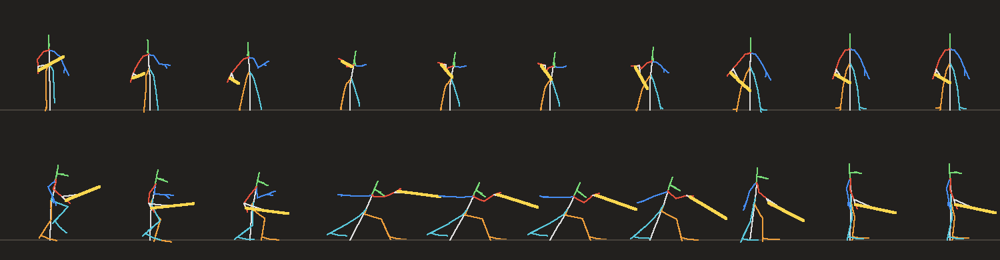

### Whirlwind (42 frames): the Spinning Sweep, a long charge let go

From the charge: wound low across the body (frame 6), unwound with both arms flung wide and the blade out flat to
his right (11), held (24) while the move spins him twice (from 22% to 62% of the move), the blade raised overhead
(29) and slammed two-handed into the floor ahead (32), back to idle (42). Four charged sweep hits around him, then
a heavy slam hit with sparks.

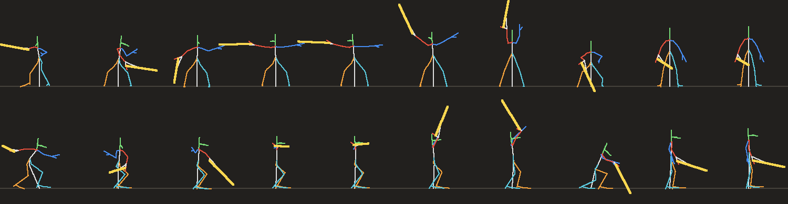

### Rising Slash (30 frames): the Counter Slash, attack while guarding

From the guard: dropped into a deep crouch with the blade trailing low behind (5), a rising cut that lifts him off
his feet (10), the blade high over his head at the top (14), down into a ready landing (20), idle (30). Untouchable;
a heavy hit at 34% and a second at 46%.

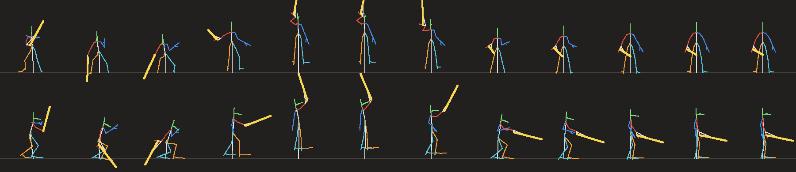

### Roll (24 frames): the evade, L2 with the stick pushed

Out of the run: a dive with both hands reaching for the floor (3), a tucked somersault in quarter turns (6, 9, 12:
the body curled, knees to the chest, the blade laid back along him, his lowest joint kept on the floor every frame),
feet planted in a split stance with the off hand on the floor and the blade trailing behind (15), the blade lifted
back over the shoulder as he pushes up (17), a forward-leaning step into his guard (19), idle (24). The blade goes up
and over on the way out, not through the floor. The move turns him the way the stick points and rolls
him that way (lunge 2.6, 3.1 with the Eternal tree's Moonwalker); he can't be hit while rolling.

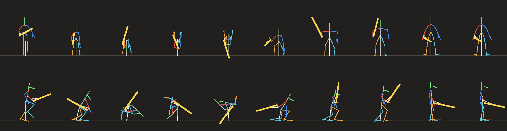

### Backstep (18 frames): the evade, L2 with the stick at rest

A quick crouch (3), a low skip straight back with the guard up, the feet at most half a unit off the floor and the
body never above standing height (5), a staggered landing with the guard still up (8), a small settle as the knees
take the weight (11), idle (18). (A higher, longer hop read as floating in game.)
The move keeps his facing and pushes him backward (`lunge_angle = 180`); he can't be hit.

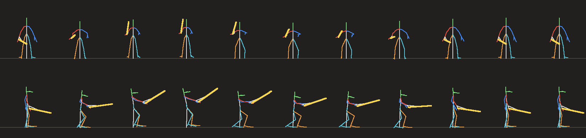

The evade takes L2 ahead of the Moonwalker/Tumbler/Rocket Boost shove dodge, for the characters that have an evade
move; the others keep that dodge. L2 still swings the camera behind him, as it always has.

### In game

| Dash Thrust (the lunge) | Whirlwind (arms wide, spinning) | Rising Slash (blade up out of the guard) |
|---|---|---|
| 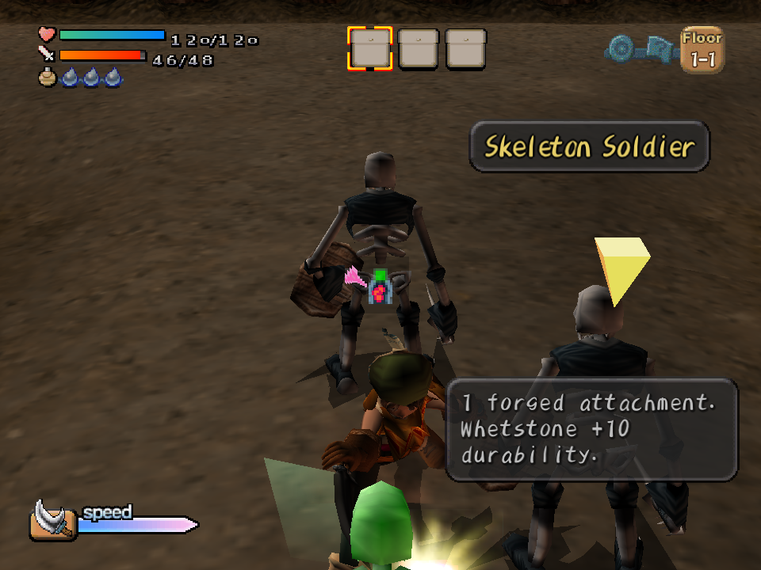 | 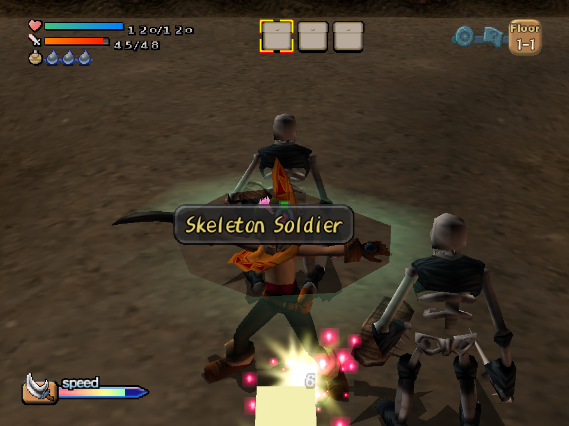 | 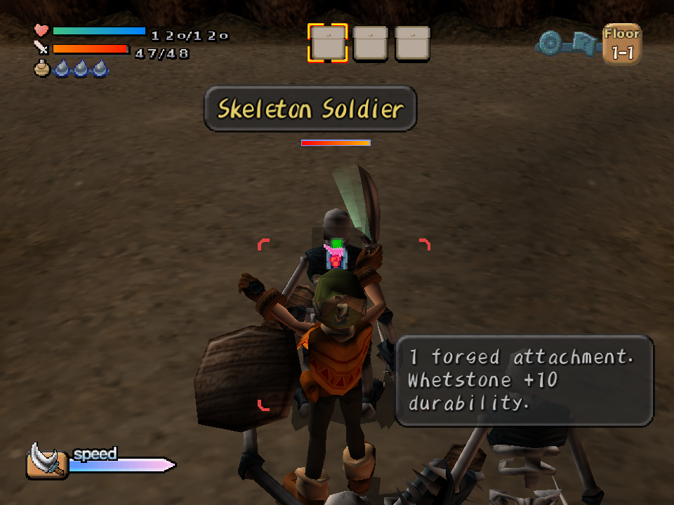 |

| Roll (diving in) | Roll (tucked) |
|---|---|
| 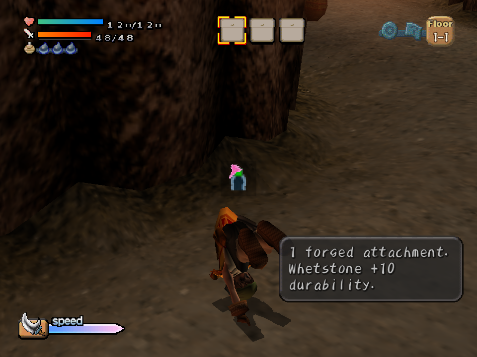 | 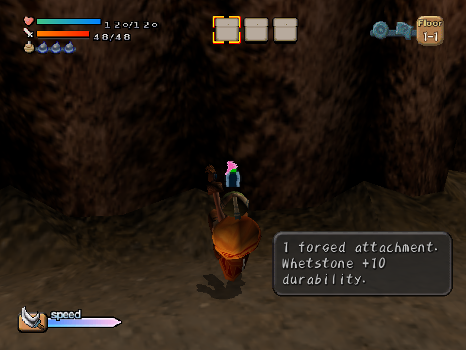 |

The endings, drawn frames 1843-1852 (roll) and 1922-1932 (backstep):

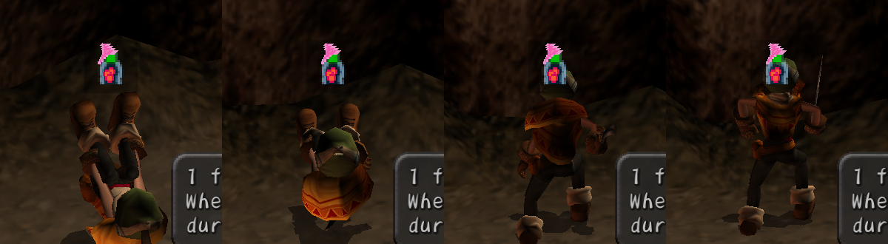
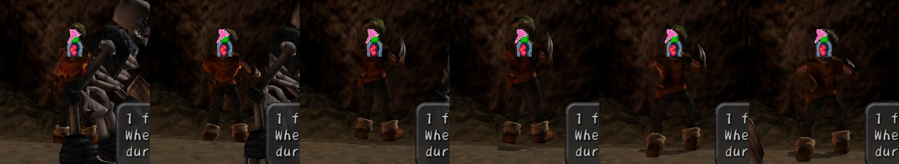

L2 cancelling a combo swing, drawn frames 1830-1872 (L2 pressed every 4 frames from the swing's start; the roll
comes right after the slash):

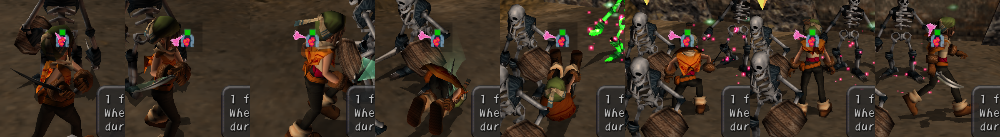

## Xiao's set

Authored in `tools/anim/xiao_moves.py` on her own rig (pack `c04b`, 42 channels, body centre `c_ctr`, ankles 0.8).
She holds the slingshot in her left hand and draws the band with her right. The shot keyposes start from her own aim
(native frame 251) and release (253.5) and change only the body and legs, so her arms aim as the game's own shot
does. Her slingshot is a separate model with its own motions, played with hers by motion number. While one of her
new motions plays, the engine holds it on its rest motion (it stays in her hand; only the band is still).

| Motion | Move | What it is |
|---|---|---|
| Triple Shot (24 frames) | `triple_shot`, attack out of a run, a full gauge like her own shot | skids into a wide low stance with the slingshot coming up (4), draws (7), lets go (10): the move fires three shots fanned 12 degrees apart, then she rides the recoil back and stands (24) |
| Tumble (24 frames) | `evade_tumble`, L2 with the stick pushed (further with Moonwalker or her Tumbler signature) | a low dive (3), a quick tucked somersault (5, 8, 11), feet planted in a split stance with a hand down (14), up into a ready crouch (18), idle (24) |
| Hop Shot (20 frames) | `evade_hop_shot`, L2 with the stick at rest | crouch with the slingshot coming up (3), a low skip straight back with it drawn (6), the shot let go at the top (7, the move fires one), a staggered landing still aiming (10), settle (13), idle (20) |

Both evades are untouchable and cancel her attack once its shot is away. Shots are a new kind of move hit
(`shot = true`, with `count`, `spread` and `speed`; see the API): real slingshot shots from the slingshot's tip,
aimed at a locked-on target as her own are.

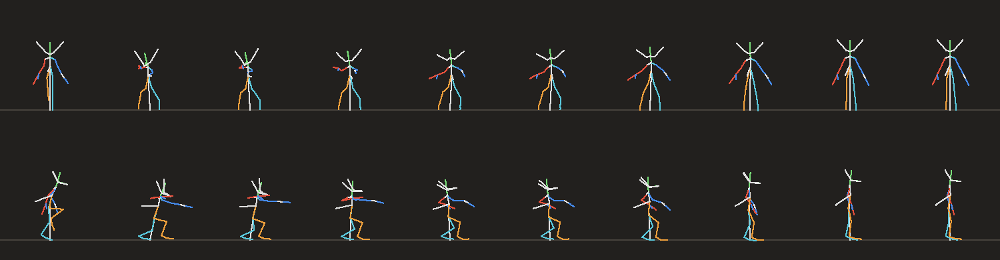
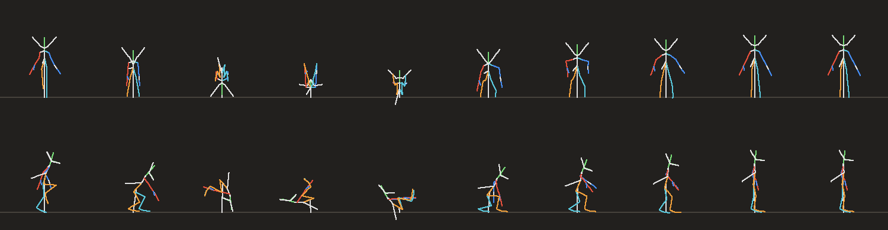
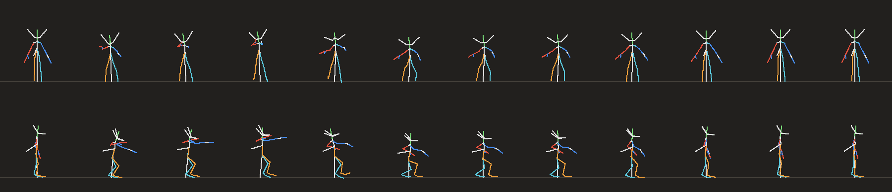

In game (from behind): the Triple Shot's skid, draw, release and recovery; the tumble; the hop shot (the shot is the
small orange dot ahead of her in the third frame).

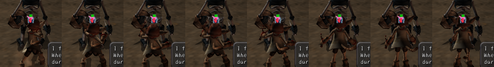
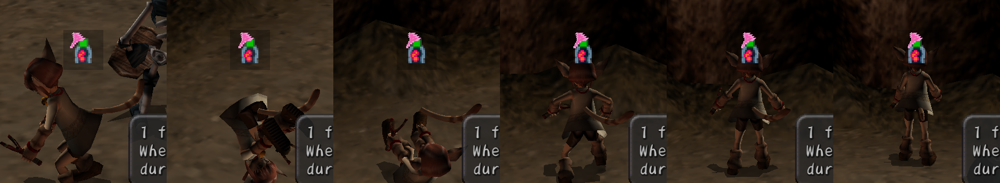
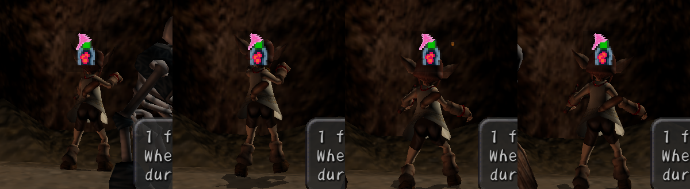

## The combo set

Light and heavy attacks and button combos, for both. A is the light attack: the native combo, unchanged. The rest are
mod moves on the engine's combo triggers (`heavy`, `combo_finisher`, `lock_attack`, `evade_attack`; see the API).

| Input | Toan | Xiao |
|---|---|---|
| R2 | Heavy Chop (`toan_heavy_chop`, 30 frames): a slow two-handed lift, a chop into the floor ahead (13), held | Heavy Shot (`xiao_heavy_shot`, 30 frames, full gauge): a braced, long, deep draw, the shot let go at 16 (2.6x), rocked back on her heels |
| A, A, R2 | Launcher (`toan_launcher`, 28 frames): out of the second swing's last frame, low, then an upward cut onto his toes (8) | Fan Shot (`xiao_triple_shot` from 15%): five shots fanned 14 degrees apart |
| A, A, A, R2 | Spin Finisher (`toan_spin_finisher`, 34 frames): out of the third swing, flung wide while the move turns him a full circle (three hits), ending on a lunging cut (20) | Volley (`xiao_volley`, 26 frames): three quick draws swept left to right, three shots each (6, 11, 16) |
| Locked on, toward + A | Lunge Thrust (`toan_dash_thrust`) | Dash Shot (`xiao_triple_shot` from 15%, lunging in) |
| Locked on, away + A | Back Slash (`toan_back_slash`, 20 frames): a flat cut right to left (6) while skipping back | Retreat Shot (`xiao_hop_shot`, backing off, two shots) |
| A late in an evade, or just after | Roll Slash (`toan_roll_slash`, 22 frames): starts on the roll's planted stance (its frame 15), a rising diagonal cut driving forward (7) | Tumble Shot (`xiao_triple_shot` from 25%, two shots) |
| Guard + A (unchanged) | Counter Slash | (none) |

The finishers start from wherever the combo's swing left Toan, so the launcher starts on native motion 0x25's last
frame and the spin finisher on 0x26's. Xiao has no combo of her own; her shots count as the chain (she fires about
once a second when mashing, inside the 90-step chain gap). Her finishers take no gauge, as her shots have just spent
it. A character with an R2 move gives up R2's first-person view in dungeons.

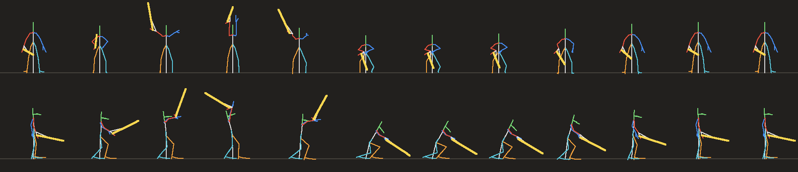
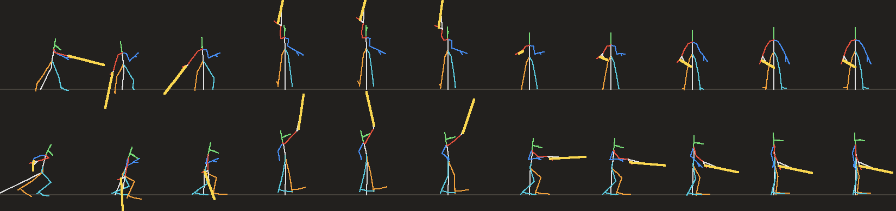
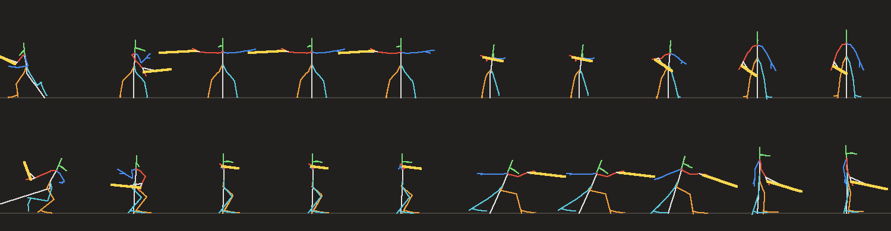
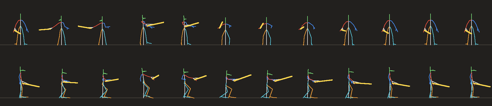
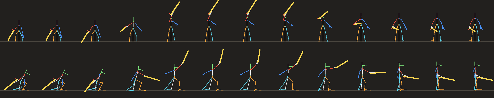
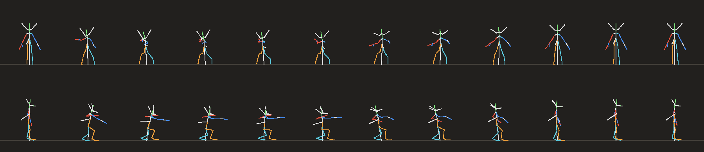
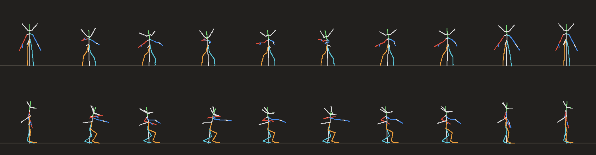

Seen in game (headless runs, the `game.player.move` events): R2 at rest gives the Heavy Chop; two swings then R2 the
Launcher and three the Spin Finisher (each cutting the swing short); locked on, the stick toward the target gives the
Lunge Thrust and away the Back Slash (checked against the stick and target headings; a lunge that carries him past
the target turns "toward" round, as it should); A late in a roll gives the Roll Slash, cutting the roll short. For
Xiao: R2 the Heavy Shot, three shots then R2 the Volley, the Dash Shot, and the Tumble Shot just after a tumble.

## The party set: Goro, Ungaga, Ruby and Osmond

The other four get the same inputs from one script, `tools/anim/party_moves.py`, rather than one hand-posed script
each. A small spec per rig names its centre, root, spine, head, the two leg and two arm chains, and the native attack
frames to borrow from: Goro's sledge swing (frames 93-105), Ungaga's spear combo (682-710), Ruby's cast (126-130) and
Osmond's gun (84-86). Two recipes then pose any rig of that kind:

- **Melee** (Goro, Ungaga): Dash (24 frames), Counter (30), Roll (24), Backstep (18), Heavy (30), Launcher (28),
  Spin Finisher (34), Back Slash (20), Roll Slash (22).
- **Caster** (Ruby, Osmond): Rush (24), Tumble (24), Hop Shot (18), Heavy Cast (30), Volley (26).

An attack keypose takes the upper body from the native frame and resets hips and legs to idle, so the native swing's
own jump or crouch doesn't stack on the recipe's lean. Distances scale by leg length against Toan's (7.8), and the
hips sink on their own when a planted foot would be out of reach (Ungaga's long lunge needed it). The tucked roll is
the same for every rig.

| Input | Goro, Ungaga | Ruby, Osmond |
|---|---|---|
| R2 | Heavy: a slow lift and slam ahead (x2.4, Goro x1.1 power) | Heavy Cast: one big shot (2.6x), full gauge (Osmond half) |
| A, A, R2 | Launcher | Fan: five shots 14 degrees apart |
| A, A, A, R2 | Spin Finisher: three spinning hits, then a lunging blow | Volley: three draws of three shots |
| Locked on, toward + A | Lunge (the Dash motion) | Dash Shot |
| Locked on, away + A | Back Slash | Retreat Shot (two shots) |
| A as an evade ends | Roll Slash | Tumble Shot |
| Guard + A | Counter | (none) |
| L2 | Roll, or Backstep at rest | Tumble, or Hop Shot (one shot) at rest |

Reach scales by weapon: Goro x0.9, Ungaga x1.3. Ruby's moves fire her magic orbs and Osmond's fire his bullets; a
Ruby shot's damage uses her attack and magic averaged. Goro's slam and Ruby's casts take a full gauge, so their chains
come slower; Osmond's gun drains the gauge as it fires, so his moves take half of it.

Seen in game (headless, `game.player.move` events) for all four: the R2 heavy, the finishers (Goro's Launcher,
Ungaga's Spin Finisher, Ruby's Fan), locked-on toward, the roll or tumble, and the evade follow-up cutting it short
(`cancel = true`); Osmond's Retreat Shot. Ungaga's finishers first did nothing: his swings run with the act flag down,
and R2 often landed as the next swing started, before its blow. The engine now lets combo actions be cut, and lets a
finisher cut any native attack while the chain is live. Osmond's finisher can miss when his gauge has run dry: R2 then
comes after the 60-step finisher window.

## Verification

Run all of these after any change to the tools, the engine part, or a motion.

| Check | How | Result (2026-10-29) |
|---|---|---|
| Conventions | `python tools/anim/verify.py <dun/mainchara> <anims>`: every native motion sampled and written as a motion file gives back the motion file's keys | all keys, largest difference 5e-06 |
| glTF in | same script: the converter's glTF action for each native motion, read by `action_to_document`, matches the motion file | 38 actions, largest difference 6.3e-06 |
| Authored files | same script: valid v1 documents, every channel keyed, frames rising 0..length, unit quaternions, first pose within 1° of a native pose, or of a pose another of the character's animations passes through (the Roll Slash starts on the roll's frame 15) (`verify.py ... xiao` for hers) | Toan's ten and Xiao's five pass; Goro's, Ungaga's, Ruby's and Osmond's (`verify.py ... goro` and so on) pass. Xiao's and Ruby's glTF-in checks differ on one action each; their authored files don't use that path |
| Deterministic | `toan_moves.py` run twice gives identical files | identical |
| Engine round trip | register a native motion (the combo finisher, frames 856-884) as a mod motion and play it with a move: it gets motion number 41 and plays as the native one does | as expected |
| Left arm | `moonanim.fk` at native idle: the left wrist mirrors the right (3.2, 8.7 vs -3.0, 8.7) | as expected. Toan's left shoulder `chn9` keeps its turn in a node matrix; before `matrix_rotation` read it, every authored left-arm pose came out wrong in game (the hand thrown up over his head) |
| Floor contact | `toan_moves.body_joints` over every frame | the roll keeps every joint at or above the floor; planted toes dip at most 0.48 (his native idle: 0.14) |
| In game | Gauntlet mod loaded, a driver switching to Toan and spawning dummies; `darkcloud --headless ... --screenshot <png> --screenshot-at <frames>` captures the motion frame by frame; a temporary print gives the engine's own counts | Toan: all five play and were re-captured after the left-arm fix; the roll and backstep fire from L2 with and without the stick; Dash hit for 9, Whirlwind charged hits for 6; the Counter's heavy hit lands for 11 with knockback (fired at an awake enemy). Xiao: all three play; the Triple Shot fires 3 shots and the Hop Shot 1, a shot hit for 4; the tumble cuts the Triple Shot short after its shots (`cancel = true`). Her own native shot ends about two steps after it fires, so L2 right after it is already a plain evade |
| Test dummies | the driver's extra dummies (the second and third spawned) never wake: their hurt spheres stay off and nothing can hit them. The first one wakes and takes hits. A "no hit" against a dummy means nothing until the target is checked | found while chasing the Counter's missing hit; the Counter was aimed right, at a sleeping dummy |
| Mod tests | `lua tools/tests/roguelike/test_runs.lua` (the moves name their animations, the files register from the package) and `test_standalone.lua` | 348 and 38 pass |
| Engine tests | `darkcloud_tests` | all pass but the 7 known baseline failures |

**Capturing a motion in game** (the run folder's `animshot.ps1` does this): an input script runs Toan (stick
`128 0 128 128` is up), then presses the move's input. The Dash is attack while running. The Whirlwind is attack
held about 160 frames, then let go. The Counter is circle to lock on, then R1 held and attack. `--screenshot-at
1850,1858,...` writes `<screenshot>_<frame>.png` at each frame. The game logic steps once every two drawn frames.

## Limits and what's next

- **Triggers:** moves start from a run, from Toan's charge, from a locked-on guard, or from L2 (an evade). L2
  also cancels an attack into the evade once the attack's blow has landed: a combo swing (the hook is in the
  swings' shared hit code, `basic_damage`, so Goro's and Ungaga's swings count too) or a mod attack move after its
  last hit. Seen in game: a combo swing and the Dash Slash each cut into the roll right after the slash, and presses
  before the blow do nothing. A player's shot counts as a blow too (the hook is in the shared shot spawner), so
  Xiao's, Ruby's and Osmond's shots can be cancelled. The same blow record counts the combo's chain for the
  finishers (a blow from a new swing adds one; more blows of the same swing don't).
- **Weapon motions:** Xiao's slingshot plays its own motions in step with her, by motion number; during one of her
  mod motions the engine holds it on its rest motion (and her first-person hand the same way). Check the other
  characters' weapons when their sets are built.
- **Root motion:** the motions keep the root still and the move's lunge moves him, so walls stop him as for a native
  lunge.
- **Cloth:** the poncho and turban are simulated by the game, so they follow any new motion on their own.
- **Caps:** a mod registers up to 64 motions and 64 moves (raised from 32 for the six-character set).
- **Next:** hand-posed signature moves for the four party members, where the shared recipes read too alike.
