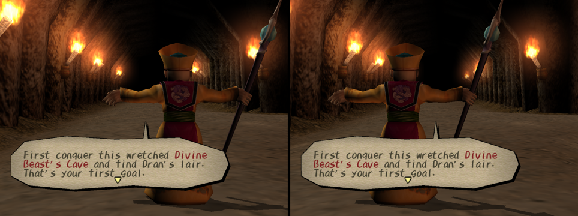

# Plan: a VR mode for Dark Cloud (Chronicle)

Status: started, 2026-11-03. DC1 (Chronicle `9418a550` + `ports/chronicle`) first; Chronicle Two follows once DC1 plays.

## The idea

Dark Cloud already has a first-person view, and it works in the dungeon, in towns and in houses. VR builds on it:
the player is always in that view, with their head pose on top of it. Nothing is played from a floating third-person
camera.

- **First person everywhere.** Walking, fighting, talking and cutscenes all play from the hero's eyes.
- **Fighting in first person.** Melee and ranged attacks, lock-on, guarding and dodging, with the weapon in view.
- **Talking and cutscenes in first person.** The scene's scripted camera is not used. The player stands where the hero
  stands and looks at whoever is talking.
- **Georama as a table you place.** The top-down Georama editor does not work as a camera in VR. Instead the town
  pops out as a miniature: you pick it up, walk (in first person) to where you want it, and set it down. You then build
  on it like a tabletop model, with the real town around you.

## What the engine already gives us

Found in the DC1 port (paths relative to the Chronicle checkout; `KZ/` is `tools/kazarov`):

| Piece | Where | What it means for VR |
| --- | --- | --- |
| Dungeon first person | `GAME_TASK_EYE_CAMERA`; enter `port/src/game/dun/movechara.cpp:1550`, pose `EyeCamera` in `dun/gameloop.cpp:6710` | Eye at the hero's head, yaw `viewAngleH__2`, pitch `viewAngleV__2`; hero model hidden (`player_visible=0`) |
| Town / house first person | `viewMode` in `port/src/game/ebattle.cpp` (`EdMoveChara`, `EdEyeCamera`) | Same idea in towns; houses always use it |
| Hand and weapon view | `CharaMainHandViewFlag`, `dun/gameloop.cpp:2600` | Already draws Xiao's hand and weapon in first person; the start of a VR weapon view |
| Camera → matrices | `MGSetViewMatrix` / `MGSetRenderInfo` in `port/src/game/mglib.cpp`, `Draw3DSceneConstants` in `port/src/render/draw3d.cpp` | One view and one projection per scene |
| **Display-list replay** | `KZ/src/cpp/gfx/displaylist.cpp` (`RenderList`, `Interpolated`) | Each game tick is recorded once. Each mesh keeps its camera, projection and model separately, and the replay already rebuilds every mesh's matrix for a new camera (frame interpolation). **This is the VR hook:** replay the tick once per eye with the head pose on top of its camera. That also solves the 60 Hz game tick against a 90 Hz headset |
| Fixed 60 Hz tick + display renders between ticks | `port/src/app/presentation.cpp` (`DisplayFrame`) | Headset frames become display renders |
| Virtual pad | `InputSetOverride` in `KZ/src/cpp/platform/input.cpp` | XR controllers can drive the game as a pad |
| Vulkan 1.3, dynamic rendering, no fixed render pass | `KZ/src/cpp/gfx/renderer.cpp`, `draw.cpp` | OpenXR's `XR_KHR_vulkan_enable2` fits: instance and device come from OpenXR, eyes are swapchain images |

## What is in the way

1. **First person is fenced off.** It exits on damage, L1, Cancel and death (`movechara.cpp:2476`). In town it blocks
   talking, ladders and villagers (`ebattle.cpp:2042-2073`). Toan, Goro and Ungaga cannot attack in it; only the ranged
   heroes aim (`movechara.cpp:2283`).
2. **Events take the camera.** Dungeon scripts switch to `SubCamera` (`btsysscript.cpp:133`), town events to
   `EventCamera` / `TalkCamera` (`editloop.cpp:1738`, `1749`), and the script opcodes `_SET_CAMERA`, `_SET_TALK_CAMERA`,
   `_SYNC_SCENE_CAMERA` (`editloop3.cpp`) move it every frame.
3. **Sprites are flat.** Effects, hit marks and particles are projected to the screen on the CPU
   (`MGRotTransPers3DSprite`, `mglib.cpp:820`). In stereo they would sit at the same spot in both eyes. The renderer
   already has a world-space path for them (`Interp2D::world_corners`, `KZ/include/gfx/gfx.hpp:849`) that the port does
   not use yet.
4. **Culling uses the flat screen.** `Draw3DVisibleExtent` and `MGClipVertex` cull to the 640×480 view. A headset sees
   a wider and differently shaped field, so culling must widen to the eye frusta.
5. **The HUD is screen-space.** It is drawn in 640×480 logical space (`port/src/render/draw2d.cpp`). In VR it goes on
   a floating panel.
6. **Narrow FOV.** The game's focal lengths give about 33° (town) and 44° (house) vertical FOV. In VR the projection
   comes from the headset per eye; the game's own is ignored for the world pass.

## Steps

Each step builds, passes the port's tests, and is checked in game before the next one starts.

### VR0: per-eye camera in the replay (engine, no headset needed) — built 2026-11-03

- `gfx::RenderOptions::eye` / `gfx::EyeView` (KZ `include/gfx/gfx.hpp`, `src/cpp/gfx/displaylist.cpp`): a view
  placed on the list's world camera (the last scene drawn to `kMainTarget`) on replay, after interpolation, with an
  optional projection of its own. Meshes, Prog0 clip matrices and eye, and depth-tested sprites follow it. HUD,
  flat 2D and other render targets' cameras keep what the tick drew. It works with interpolation on or off.
- `DC_VR_DEBUG_EYE="x[,y[,z]]"` (port `port/src/app/presentation.cpp`): every presented frame, and `--screenshot`
  and `--screenshot-at` captures, show the world from that far over in the camera's space.
- Tests: `GfxGpuMeshDc2.EyeViewMovesTheWorldCamera` and `EyeViewMovesProg0Draws` cover the eye's view and its
  projection, for plain and Prog0 meshes. All 158 renderer tests pass. In the full port suite, 7 fail
  (`PlatformMc.Seek*`, `PlatformMc.EndReturnsZeroAndKeepsOpenFiles`, `DataRead.MetadataSnapshotsStayFreshWhenDisabled`,
  three `Localize*`). They fail the same way in `dc1-aerial-build`, which has no VR changes.
- Seen in game (Divine Beast Cave B1, headless, eyes at ±3): the cave and the mayor shift between the eyes while the
  dialogue box stays put (`docs/images/vr0_stereo_pair.png`).
- The changes live as their own patches, `ports/chronicle/vr/vr-chronicle.patch` and `vr-kazarov.patch`, applied
  on top of the two MoonFactory patches. They are folded into the main patches once VR is ready.

### VR1: OpenXR session — built 2026-11-03, plays on a Quest 3 over Link

- **Loader:** OpenXR-SDK `release-1.1.63`, fetched and linked statically (`KZ/cmake/KazarovOpenXR.cmake`). It is on
  by default for desktop Windows and Linux (`KZ_PORT_OPENXR`); other builds get stubs that report no runtime.
- **Starting it:** `darkcloud --vr` (or `DC_VR=1`), with `--vr-scale N` for game units per metre (default 9, so the
  hero's eye at about 14 units is about 1.6 m). With no runtime or no headset, the game logs why and plays on the
  window as usual. That fallback is checked on this PC, which has no runtime installed.
- **Vulkan through the runtime** (`KZ/src/cpp/gfx/xr.cpp`, hooks in `renderer.cpp`): `XR_KHR_vulkan_enable2` creates
  the instance and device, the GPU is the one the headset is on, and the session starts once the device exists.
  Each eye gets its own swapchain at the runtime's recommended size.
- **Eyes** (`EyeView::headset`, `gfx::HeadsetEyeMatrices`): each eye's pose and field come from `xrLocateViews` in
  LOCAL space, relative to a home that starts where the head is (yaw only) and that `xr::Recenter` resets. The pose
  goes into the game's eye space, which faces +x right, +y down, +z ahead. The x and y rows of the projection are
  rebuilt from the eye's field. Depth keeps the game's own rows, so fog, depth tests and the depth queries keep
  their meaning.
- **Frames** (`HeadsetFrame` in `port/src/app/presentation.cpp`): between ticks, each headset frame waits on the
  runtime, replays the newest tick once per eye (interpolated when interpolation is on), copies the display image
  into the eye's swapchain image, and submits a projection layer. The window mirrors each tick once. Quitting from
  the headset's menu quits the game.
- **sRGB:** the game draws sRGB-encoded values into UNORM images. An sRGB swapchain is filled byte for byte through a
  UNORM scratch image, so colours look the same as on the window.
- **Tests:** `GfxXr.*` (field edges, depth kept, eye spacing in world units, head turns and tilts centring the
  right point, no eye without perspective).

Seen in a headset 2026-11-03: a Quest 3 over Link runs at its 72 Hz with both eyes in every frame, and the Meta XR
Simulator runs it too. Fixed since:
- **Eye resolution:** the main targets grow to the eye's height (`g.min_target_height`, `MainExtent()`), keeping the
  window's shape, so each eye is drawn at the headset's resolution whatever the window's size.
- **Frames from the start:** the async present path asks the runtime for frames as soon as XR is on, so the session
  can start at all on the render thread.
- **Frame trace:** the log carries the first frames' steps and, every 5 seconds, the frame count, how many had a
  layer, and the worst gap.

### VR2: first person everywhere (game side) — mostly built 2026-11-03

Built, and checked in the simulator by eye:
- **The view at the hero's eyes** (`port/src/game/vr_view.cpp`, `VrEyeView`). The game keeps playing in its usual
  third-person mode, so walking, fighting and every system work unchanged. Only the view drawn moves: to the hero's
  head, level. The hero's body is not drawn; its shadow is.
- **Where:** dungeons (`DunMainDraw`: playing, menus and scenes), towns (`VrTownFirstPerson`: walking, talking, menus
  and scenes, not the Georama) and house interiors (`edit_in.cpp`).
- **Talks and scenes** face what the scene's camera looks at, usually the one talking: one snap when the scene starts,
  and again only if the subject moves more than about 60 degrees away.
- **The cinema screen** (`xr::SetCinema`, `SubmitCinema`): anything shown through the game's own moving camera plays
  on a still 3.2 m screen 3 m ahead, in a dark room, exactly as the game frames it. That covers scenes the hero is not
  in (`player_draw` off), the opening, the rush movie and the title (`VrCinema()`), and in towns the Georama and the
  game's own look-around until the Georama table exists. The screen is placed where the head faces as the film starts.
  A camera flying about the player's head is what sickens most, so this is a comfort choice first.
- **Nothing is culled to the game's view** on a headset: dungeon cells behind the game's camera (`dungeonmap.cpp`) and
  frames off its screen (`frame.cpp`) are drawn, so the player can look any way. Frame times did not change.
- **Comfort pass** (built 2026-11-03, because the player who tests this gets motion sick; see Testing):
  - The view never turns unless the player turns. The body keeps its facing (`VrFacing::Body`) while the game's camera
    swings about behind it; only a snap turn or a scene's snap changes it.
  - The stick walks where the head looks, from any pad: walking (`DunMoveChara`, `EdMoveChara`) turns the stick by
    `VrWalkAngle` instead of the game camera's angle. Menus read the stick untouched.
  - A flick straight sideways snap-turns 45 degrees, once per flick: the right stick on a gamepad (`VrTurnStick`), the
    only stick on a Touch controller (`HeadsetPad`).
  - A dark ring closes in from the edges of sight while the view moves or turns without the head: walking, and a scene's
    camera gliding. Strength follows speed up to walking pace (`Comfort` in `vr_view.cpp`); cuts and snaps (big jumps)
    don't count. It is a head-locked quad layer (`CreateVignette` in `xr.cpp`) whose size is its strength, since the
    simulator lacks `XR_KHR_composition_layer_color_scale_bias`. It lapses if the game stops setting it.
- **Flat 2D on a screen** (`EyeView::ui`, `PlaceFlatUi` in `displaylist.cpp`): menus, text and the HUD stand on one
  1.6 m wide screen 1.6 m ahead and 0.3 m below the eyes, the same in both eyes. It follows the head once it turns
  more than about 35 degrees away. Fades and screen effects still cover the whole eye. So does any sprite over the
  whole frame (a sky tint), which the eye replay would otherwise shrink.
- **The live doorway view** (`DoorwayLive`) is off in VR: its flat picture fits only the game's own camera.

Still to do:
- A soft fade between first person and the cinema screen; today it cuts.
- Occasional long frame gaps (100-450 ms, every few seconds) show in the simulator runs, before and after this work.
  On a headset a hitch is a comfort problem; find whether they are the game's or the simulator's.
- 3D sprites (effects, hit marks) still move corner by corner rather than sitting in the world.

### VR3: fighting in first person

- Every hero can attack, guard and dodge in first person. The existing attack animations still play; what the player
  sees is the weapon and hand model, extended from Xiao's existing hand view to every hero and weapon.
- Lock-on shows as a marker on the target. The view never snaps to it.
- Camera motion from moves (rolls, the follow-camera step in `animations.motion_register`) is not applied to the head.
- Comfort settings: snap angle or smooth turning, vignette strength, no head bob. Snap turn and the vignette are built
  (VR2's comfort pass); the settings to change them are not.
- Later, optional: swing the controller to swing the weapon. This needs its own design, because attacks are driven by
  animation today.

### VR4: Georama table

- In VR, opening Georama doesn't switch to the top-down camera. The town appears as a miniature you hold.
- Walk to a spot and set it down at table height. It stays there, anchored in the world, until you pick it up again.
- Edit on the table: point at a spot and place, turn and move parts. The real town around you updates as you build.
- Under the hood the Georama scene is rendered with its own camera into the table's place in the world, using the same
  per-camera replay as VR0.

### VR5: controllers, HUD and the Lua API

- Built 2026-11-03: one Touch controller plays it all (either hand; `xr::ReadControls`, `InputSetHeadsetPad`,
  `HeadsetPad` in `port/src/main.cpp`). Stick walks, trigger is Cross, A/X Circle, B/Y Triangle, grip R1, stick
  click Square, A+B or the left menu button Start. Still to do: remapping, and hand tracking. Link offers no
  `XR_EXT_hand_tracking` unless Developer Runtime Features is on in the Link app.
- The HUD, menus and the Vigil pages stand on a floating screen (built in VR2, drawn into the eyes rather than as a
  quad layer). Still to do: aiming at it with a pointer.
- `game.vr` for mods: `active()`, `head()` (pose), `recenter()`, `comfort_get/set`. Documented in `docs/API.md` and
  the modding guide.
- Settings page: world scale, seated/standing, turn style, vignette, panel distance.

### Later: Chronicle Two

Same plan on the Chronicle Two port, which shares Kazarov, so VR0 and VR1 carry over and only the game-side steps
are new.

## Testing

- VR0 is checked on a flat screen (`DC_VR_DEBUG_EYE`) and with Kazarov GPU tests.
- **Without the headset, use the Meta XR Simulator** (installed under `C:/Program Files/MetaXRSimulator/v207.1`).
  Point only the game at it, with no system change:
  `XR_RUNTIME_JSON="C:/Program Files/MetaXRSimulator/v207.1/meta_openxr_simulator.json" darkcloud --vr ...`.
  If the simulator's own toggle is on, it is the system runtime and the Quest won't get the game.
- **Seeing the eyes:** with a headset session running, `--screenshot X --screenshot-at F` also writes `X_F_left.png`
  and `X_F_right.png`, each eye's image. Good starts: `--jump dungeon:1` (no tutorial), `--jump e01` (Norune),
  `--jump house:i01h01@150` (a house scene). Input scripts move the stick with `frame lx ly rx ry`.
- `KZ_VR_UI_TRACE=path:N` writes the flat draws placed on the screen every Nth placement, to find what lands there.
- `KZ_XR_FAKE_YAW=degrees` makes the head read as turned that far left, to check head-led walking without a headset.
- The 5-second `xr:` log line reports the comfort ring's strongest strength (`ring 0.80` while walking) and how many
  frames went to the cinema screen. The ring and the screen are composited by the runtime, so they are not in the eye
  captures; the simulator's window shows them. A capture on the cinema screen writes `X_F_cinema.png`, the flat frame.
- Input scripts drive the game pad, not a Touch controller: `frame 128 128 255 128` flicks the right stick (a snap turn).
  `--jump opening` plays the opening, on the cinema screen.
- **The user gets motion sick in the headset and can't test.** Every change is checked here, in the simulator, and
  comfort is reasoned out: no view turn the player didn't make, snaps over smooth turns, the ring while moving.

## Where the work lives

The engine work is carried in `ports/chronicle/moonfactory-chronicle.patch` and `moonfactory-kazarov.patch`, like
every other engine change. It is built in its own check tree, `E:/Gauntlet-build/vr-check` (build in
`E:/Gauntlet-build/vr-build`), so it does not get in the way of other sessions' work in `dc1-aerial-check`. It goes
into the shared patches once it is ready.

To rebuild the check tree: clone Chronicle at `9418a550` with Kazarov at the commit the patch names, apply
`moonfactory-chronicle.patch` and `moonfactory-kazarov.patch`, then `ports/chronicle/vr/vr-chronicle.patch` (in the
checkout) and `vr-kazarov.patch` (in `tools/kazarov`). To regenerate the VR patches from it, diff against the
MoonFactory base commit in each repo (`git diff HEAD -- port` and `git -C tools/kazarov diff HEAD`).
